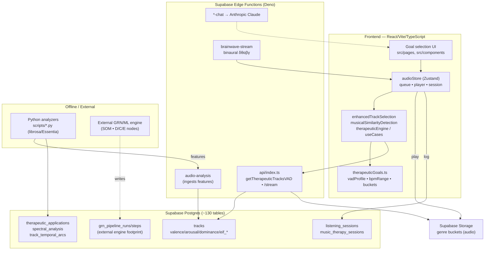
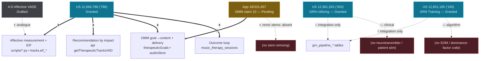
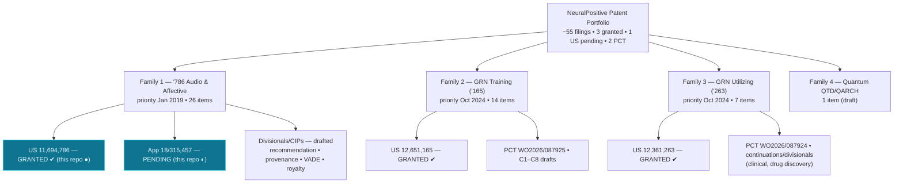

# Diagrams — Reduction-to-Practice Drawings

Companion to [`README.md`](./README.md). Mermaid source renders on GitHub and in the data-room
artifact. Four drawings: (1) system architecture & data flow, (2) the '786 affective
reduction-to-practice pipeline, (3) patents → code evidence map, (4) portfolio map.

---

## Drawing 1 — System architecture & data flow

---

## Drawing 2 — The '786 affective reduction-to-practice pipeline

```mermaid
flowchart LR
    A["Audio work\n(digital audio file)"] --> B["Feature extraction\nscripts/real_audio_analyzer.py\nkey•tempo•spectral•MFCC"]
    B --> C["Affective measurement\nvalence=mood_happy\narousal=mood_energetic\ndominance=energy×brightness\ntense=1−calm"]
    C --> D["EIF scoring\neif_valence/arousal/total\n+ track_temporal_arcs (trajectory)"]
    D --> E["Goal / condition mapping\ntherapeuticGoals.ts vadProfile\ntherapeutic_applications evidence"]
    E --> F["Recommend by emotional impact\ngetTherapeuticTracksVAD\nenhancedTrackSelection"]
    F --> G["Sequenced session\ntherapeuticEngine / useCases\nCamelot harmonic flow"]
    G --> H["Deliver & play\naudioStore • /stream"]
    H --> I["Outcome / closed loop\nlistening_sessions\nmusic_therapy_sessions\npre/post mood • GAD-7/PHQ-9/PSQI"]
    I -.feedback.-> E
```

---

## Drawing 3 — Patents → code evidence map

Legend: **●** reduced to practice here · **◐** partial · **○** integrated externally · **—** not present.

---

## Drawing 4 — Portfolio map

---

*Rendering: GitHub renders Mermaid natively in Markdown. For a slide/PDF export, open the
data-room artifact (HTML) which renders these same diagrams.*
