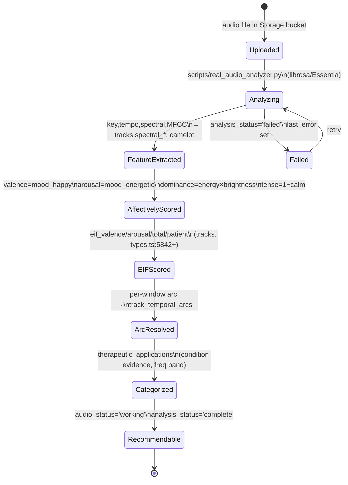
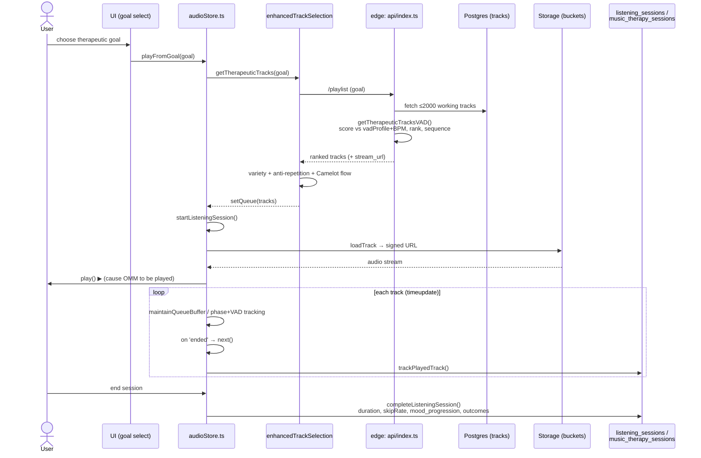
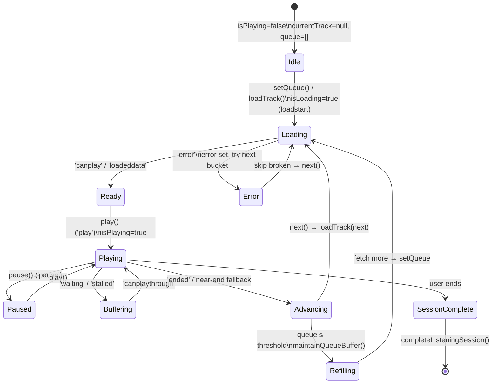
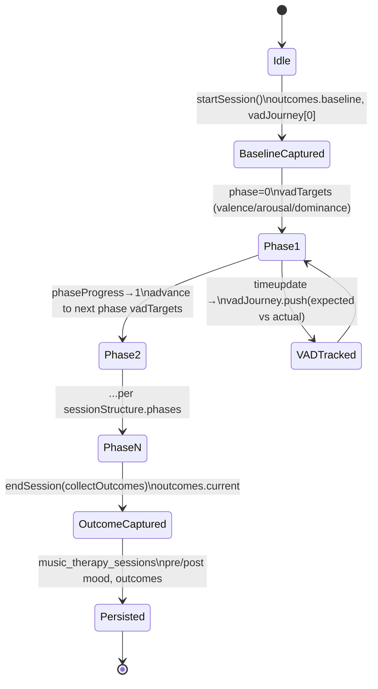
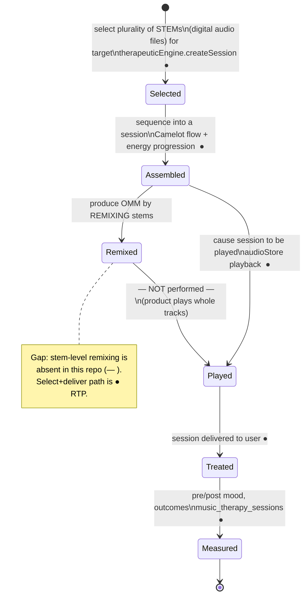
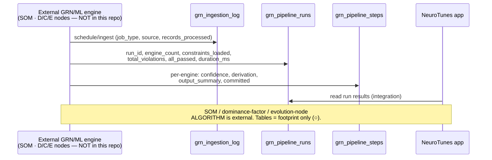

# State-Flow & Sequence Proofs of Reduction to Practice

Companion to [`README.md`](./README.md) and [`claim-charts.md`](./claim-charts.md).

Reduction to practice is shown by an **actual working embodiment**. The diagrams below trace the
*runtime behavior of the shipping system* — real states, real events, real function calls, and
real database writes, each cited to source. They are grouped as:

1. Track data lifecycle — proves **affective measurement & EIF scoring** ('786)
2. Live session sequence — proves **recommend-by-impact + deliver** ('786 / OMM)
3. Player state machine — proves **delivery / "cause the OMM to be played"**
4. Therapeutic session state machine — proves **goal-directed dosing + closed-loop outcome**
5. OMM claim-10 stateflow — element-annotated (what is ● vs. — )
6. GRN pipeline integration sequence — the external-engine footprint (○, not RTP here)

All Mermaid renders natively on GitHub and in the data-room artifact. Verdicts:
**●** RTP here · **◐** partial · **○** external · **—** absent.

---

## 1. Track data lifecycle — affective measurement & EIF ('786) ●

*Every track transitions through measured states; the state is persisted, so the measurement is
reproducible — the hallmark of the '786 "reproducible signature" concept.*

**Proof anchors:** `scripts/real_audio_analyzer.py:121-165`; `supabase/functions/audio-analysis/index.ts:178-252` (write contract); columns in `tracks`, `spectral_analysis`, `track_temporal_arcs`, `therapeutic_applications`.

---

## 2. Live therapeutic session — recommend-by-impact + deliver ('786 / OMM) ●

*A single end-to-end runtime trace: goal in, ranked affective media out, played, outcome recorded.*

**Proof anchors:** `audioStore.playFromGoal:1361`, `setQueue:1485`, `loadTrack:920`, `next:1872`, `startListeningSession:34`, `completeListeningSession:71`; `api/index.ts getTherapeuticTracksVAD:175-277`; `enhancedTrackSelection.ts`.

---

## 3. Player state machine — "cause the OMM to be played" ('786 / claim 10) ●

*The `<audio>` element is driven through explicit states by 20 wired event handlers — the literal
delivery mechanism. States/flags are real (`isPlaying`, `isLoading`, `currentTrack`, `error`).*

**Proof anchors:** event handlers `audioStore.ts` (`loadstart:708`, `canplay:1139`, `play:602`, `pause:670`, `waiting:688`, `ended:517`, `error:548`, `timeupdate:721`); `maintainQueueBuffer:372`; state flags at `:207-268`.

---

## 4. Therapeutic session state machine — goal-directed dosing + closed loop ●

*The session advances through clinical **phases**, each with its own **VAD targets**, while
recording an expected-vs-actual **VAD journey** and baseline→outcome measurements.*

**Proof anchors:** `src/hooks/useTherapeuticSession.ts` (`startSession`, `phase`/`phaseProgress:181-200`, `vadTargets:207`, `vadJourney:224`, `endSession:138`, `outcomes:252`); `therapeuticUseCases.ts` phase `vadTargets`, `measurableOutcomes` (GAD-7/PHQ-9/PSQI).

---

## 5. OMM claim-10 stateflow — element-annotated

*App. 18/315,457 claim 10: select STEMs → produce OMM by remixing → treat by playing. Each
transition is tagged with its reduction-to-practice verdict.*

**Verdict:** the select-assemble-play-treat-measure spine is ● reduced to practice; the
**remixing** limitation is **—** absent (see [`claim-charts.md` Chart B](./claim-charts.md#chart-b--app-18315457-claim-10-omm-pending)).

---

## 6. GRN pipeline integration — external engine footprint (○, not RTP here)

*Shown for completeness and honesty: the GRN engine ('165/'263) runs **outside** this repo and
writes results here. This proves integration, not reduction to practice of the GRN methods.*

**Proof anchors:** `grn_pipeline_runs`, `grn_pipeline_steps`, `grn_ingestion_log` in `src/integrations/supabase/types.ts`. No SOM/dominance-factor source in this repo — see [`README.md §5`](./README.md#5-what-is-not-reduced-to-practice-in-this-repository).

---

*See [`traceability.md`](./traceability.md) for the claim-element → runtime-observable proof
ledger, and [`README.md §8`](./README.md#8-important-disclaimers) for disclaimers.*
